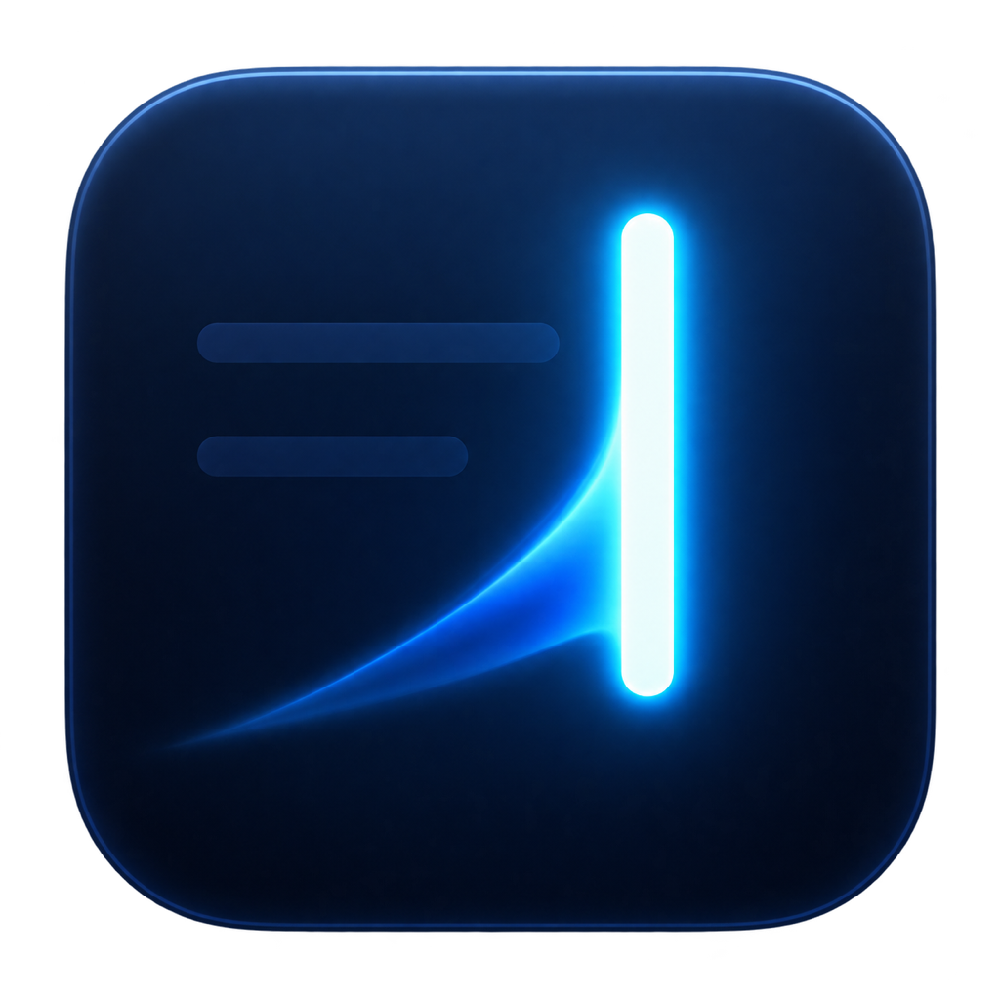

<p align="center">
  
</p>

# Caret Trail

**Keep your place. Enjoy every move.**

A fluid, luminous trail helps your eyes follow the text cursor as you write, edit, and jump around the page. Caret Trail brings a little more life to everyday typing on your Mac, then gently fades back into the cursor you already know.

Pick a color or follow your Mac’s accent color. Set the pace from a quick flicker to a longer glide. Your usual text cursor stays in place throughout.

## Try it

Requires **macOS 14 or later** and Apple’s **Xcode Command Line Tools**. Build a local copy:

```sh
git clone https://github.com/evbuildsnet/caret-trail.git
cd caret-trail
CODESIGN_IDENTITY=- ./build.sh
open build/CaretTrail.app
```

Enable **Caret Trail** in **System Settings → Privacy & Security → Accessibility**. It starts following your cursor as soon as permission is granted. Switch to TextEdit and try arrow keys, typing, or clicking between paragraphs.

Open Caret Trail to change the color, adjust the trail’s duration, or turn it off.

## A few edges

- Works in apps that expose their text cursor to macOS Accessibility; some fields, including Chromium’s address bar, don’t.
- The trail pauses while text is selected and returns when you place the cursor again.
- Editors with their own cursor animation show both; per-app exclusions aren’t available yet.

For contributors: [how it works, signing, and development checks](docs/architecture.md).
